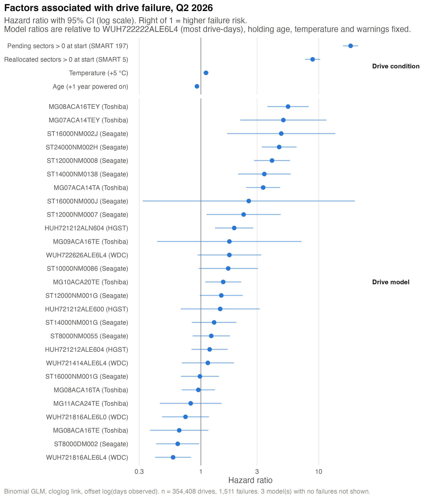
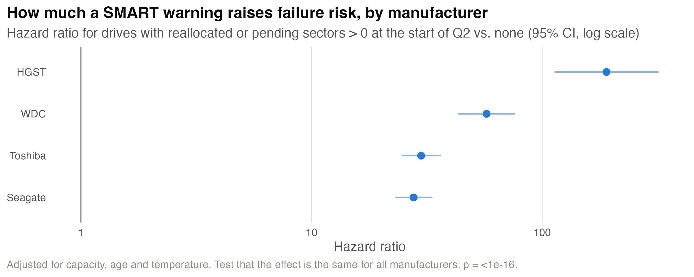

# Regression results: Backblaze Q2 2026 (Sungmin)

## Summary
- **Drive model matters even after adjusting for age, temperature, and warnings** (LRT χ² = 502.9, df = 30, p < 10⁻¹⁶).
  - Lowest risk: WDC WUH721816ALE6L4 and Seagate ST8000DM002.
  - Highest risk: Toshiba MG08ACA16TEY and MG07ACA14TEY.
- **SMART warnings are the strongest signal.** 69% of drives that failed already had reallocated or pending sectors on their first day in Q2, compared with 6% of drives that did not fail.
- **The warning effect differs by manufacturer** (p < 10⁻¹⁶). It is strongest for HGST, where 285 of 300 failed drives showed a warning at the start of the quarter.

## Data used
- **Raw data:** 91 daily CSVs (Q2 2026, about 12 GB, 197 columns) → 31,968,003 drive-days, 359,101 drives, 1,522 failure records.
- **After exclusions:** 354,415 drives, 31,553,350 drive-days, 1,516 failures. We dropped boot drives (< 1 TB), drives from other manufacturers, and models with ≤ 100 drives or ≤ 10,000 drive-days. The drive-day total matches Backblaze's official Q2 2026 figure exactly.
- **Regression sample:** 1,511 failures, after dropping 5 drives with missing age or temperature.

## Figures

**Figure A: Factors associated with drive failure.** Hazard ratios with 95% CI, log scale.

**Figure B: How much a SMART warning raises failure risk, by manufacturer.**

The numbers behind each figure are in `results/reg_main_coefficients.csv`, `results/reg_warning_by_mfr.csv`, and `results/reg_summary.txt`.

---

## Draft text for the report body

### Methods (regression)
We modeled each drive's probability of failing during Q2 2026 with a binomial GLM, using a complementary log-log link and an offset of log(days observed). This is the drive-level form of a per-day failure model. exp(coef) is a hazard ratio, which is close to an odds ratio because failures are rare.

Predictors were drive model, age (power-on years), mean temperature, and indicators for reallocated (SMART 5) and pending (SMART 197) sectors. The SMART indicators were measured on each drive's first day in the quarter, before any failure. We excluded boot drives and models with ≤ 100 drives or ≤ 10,000 drive-days. Model names recorded with and without a manufacturer prefix were merged.

A second model replaced drive model with manufacturer and capacity, and let the warning effect differ by manufacturer.

We report Wald 95% intervals and likelihood-ratio tests. We checked rare-event bias with events per parameter and multicollinearity with VIFs.

### Results
After exclusions, the regression covered 354,415 drives, 31.6 million drive-days, and 1,516 failures. Drive model remained strongly associated with failure after adjusting for age, temperature, and warning signals (likelihood-ratio χ² = 502.9, df = 30, p < 10⁻¹⁶). Relative to the most common model (WDC WUH722222ALE6L4):
- Lowest risk: the WDC WUH721816ALE6L4 (hazard ratio 0.58, 95% CI 0.41–0.83) and Seagate ST8000DM002 (0.64, 0.42–0.97). Three Seagate models (ST12000NM000J, ST14000NM000J, ST8000NM000A) had no failures.
- Highest risk: the Toshiba MG08ACA16TEY (5.50, 3.68–8.22) and MG07ACA14TEY (5.01, 2.16–11.64).

SMART warnings present at the start of the quarter were the strongest predictors:
- Drives with pending sectors had 18.7 times (16.1–21.6) the failure hazard of comparable drives without them.
- Drives with reallocated sectors had 8.9 times (7.7–10.3) the hazard.
- Of the drives that failed, 69% already showed one of these warnings on their first day in Q2, compared with 6% of drives that did not fail.

Each 5 °C of temperature was associated with a 10% higher hazard (1.05–1.16). Age had a slightly negative coefficient (0.93 per year) once drive model was included. Unadjusted failure rates rise from about 1.3% for drives under two years old to about 4% for drives over six, so the aging effect is captured mainly by differences between model cohorts (VIF for age = 4.8).

The size of the warning effect differed by manufacturer (χ² = 86.7, df = 3, p < 10⁻¹⁶). A warning raised the failure hazard about:
- 28-fold for Seagate
- 30-fold for Toshiba
- 57-fold for WDC
- 190-fold for HGST

For HGST, 285 of 300 failed drives had shown a warning at the start of the quarter. With 44 failures per estimated parameter, rare-event bias is small. However, six of the 31 models had fewer than five failures, so their intervals are wide.

### Sensitivity check
If the warning flags use the quarter **maximum** instead (which includes the failure day), the pending-sector hazard ratio rises from 18.7 to 26.7. The reallocated-sector ratio barely changes (8.9 → 9.0). Measuring warnings before failure is therefore more conservative, and the effect remains large.

### Computation (laptop run; replace with the CHTC run if we do one)
- **Hardware:** a single MacBook Pro, running sequentially.
- **Building the tables:** 15.8 minutes, with peak R memory of about 0.4–0.5 GB.
- **Data sizes:**

  | stage | size |
  |---|---|
  | raw daily CSVs | ~12 GB |
  | slim per-day files | 381 MB |
  | `drives.csv` | 29 MB |
  | `window.csv` | 3.4 MB |
- **CHTC version:** the same script splits into 91 `day` jobs plus one `combine` job.

### Limitations (regression)
- The results show association, not causation, and come from a single quarter.
- SMART values are defined and reported differently by each manufacturer. SMART 187 is missing for every non-Seagate drive, so it was not used.
- For drives that joined mid-quarter, the "first day" is their installation date.
- 541 WUH721816ALE6L4 drives were recorded without the "WDC" prefix and had a much higher failure rate (4.87% vs 1.13%). We merged the two spellings, and the cause of the difference is unknown.

---

## Notes for the team
1. **Proposal wording:** the Methods section says "logistic regression." Should we change it to the wording above, or keep "logistic" and add one sentence explaining the cloglog/offset version?
2. **Abe's Graph 2** uses failure-day values and includes SMART 187, which is Seagate-only. To match this analysis, consider using first-day values and dropping 187.
3. **Data section:** the numbers above (359,101 drives, 31,968,003 drive-days, and the exclusions) can go straight into the Data description.
4. **Pre-failure window:** `window.csv` is ready. It has 1,205 failed drives with a full 14-day window plus 2,000 healthy drives. Ask me if someone wants it for the window graph.
5. **CHTC:** for the computation section, someone can run `build_tables.R` as 91 `day` jobs plus 1 `combine` job and record time, memory, and disk.
